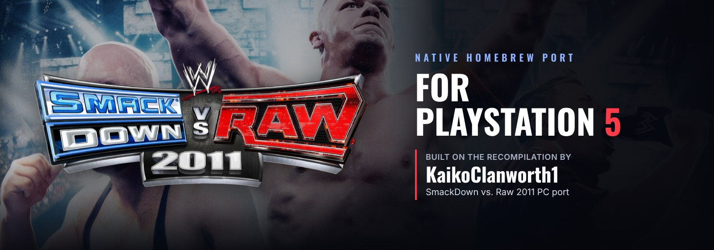
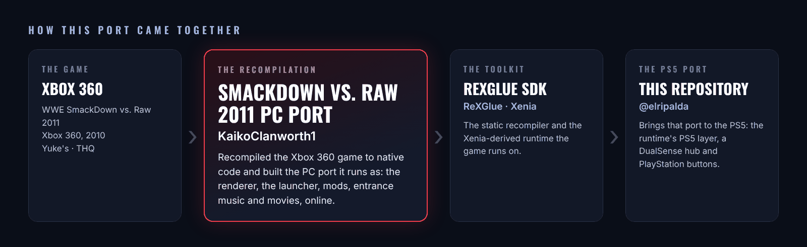

<p align="center">
  
</p>

<p align="center">
  <a href="../../releases/latest"></a>
  
  <a href="https://github.com/KaikoClanworth1/wwe-svr2011-pc"></a>
  <a href="https://discord.gg/GgDE5Vynyu"></a>
</p>

<p align="center">
  <b>WWE SmackDown vs. Raw 2011</b> running natively on a jailbroken PS5,<br>
  a port of <a href="https://github.com/KaikoClanworth1/wwe-svr2011-pc"><b>KaikoClanworth1's SmackDown vs. Raw 2011 PC port</b></a>.
</p>

<p align="center">
  <a href="../../releases/latest"><b>Download</b></a> ·
  <a href="#install">Install</a> ·
  <a href="#controls">Controls</a> ·
  <a href="#building-from-source">Build from source</a> ·
  <a href="#credits">Credits</a>
</p>

---

<p align="center">
  
</p>

> [!NOTE]
> **This is a port of someone else's project.** The recompilation of SmackDown vs. Raw 2011, its renderer, launcher, mods, entrance music and movies, and nearly everything the game does here are the work of **[KaikoClanworth1](https://github.com/KaikoClanworth1)** and the [wwe-svr2011-pc](https://github.com/KaikoClanworth1/wwe-svr2011-pc) project. This repository adds what the PS5 needs to run it: the runtime's PS5 layer, a hub made for the DualSense, and PlayStation button pictures. If you enjoy it, go give the original project a ⭐.

## What it is

A PS5 homebrew app (title ID `PPSA92011`) that runs SmackDown vs. Raw 2011 as native code. It isn't an emulator: the Xbox 360 game was statically recompiled with the [ReXGlue SDK](https://github.com/rexglue/rexglue-sdk) by the PC port, and this app runs that same code on ReXGlue's PS5 platform layer, drawing with Vulkan (Mesa RADV).

It opens on its own **hub**, the PC port's launcher made for a controller.

> [!IMPORTANT]
> **No game files are included.** You need your **own Xbox 360 copy** of SmackDown vs. Raw 2011 as a disc image (`.iso`). Everything else is in the download: the app, the hub, and the PC port's shaders, PlayStation button icons and bundled mods.

## Features

- **60 fps up to 4K**, with anti-aliasing and the PC port's graphics options.
- **The hub**: Home, Settings, Mods, Roster, Textures, Music, Movies, Paint, Saves, Online, DLC and About pages, all driven by the DualSense, with menu music (a random song each time, **R3** for the next, and a volume setting).
- **The PC port's bundled mods**: 23 superstars, 5 arenas and 11 match types, set up the first time the app opens. Turn them on in the Mods page.
- **The PC port's extras**: `.svrmod` mods, your own entrance music and movies, up to 10 HD logos per created superstar, Paint Tool import and export, save backups.
- **PlayStation buttons** in the game's menus and prompts.
- **An on-screen keyboard** in the hub's style for names and text.

## Install

You need a jailbroken PS5 that runs homebrew apps from `/data/homebrew/`, with a homebrew launcher that lists them.

**With the app store:** install SmackDown vs. Raw 2011 and give it your disc image. It puts the app in `/data/homebrew/PPSA92011/` and the game's files beside it. Start the app: the first time, it sets up the bundled mods (a minute or so; the bottom of the hub says so). Then press **START GAME**.

**By hand** (an FTP client and a tool that extracts Xbox 360 disc images, such as extract-xiso):

1. Download the latest `SvR2011-PS5` zip from [Releases](../../releases) and unzip it on your PC.
2. Over FTP, copy the `PPSA92011` folder into `/data/homebrew/`.
3. On your PC, extract your disc image (leave out `$SystemUpdate` and `nxeart`).
4. Over FTP, copy the extracted files **straight into** `/data/homebrew/PPSA92011/`, beside `eboot.bin` (not in a subfolder): `default.xex`, `plist360.arc`, `plist360_4x3.arc`, `pac/`, `sound/`, `movies/`. About 5.3 GB.
5. Start **SmackDown vs. Raw 2011** from your homebrew launcher. The first time, it sets up the bundled mods; then press **START GAME**.

**DLC** is optional: put the Xbox 360 content packages in `/data/homebrew/PPSA92011/DLC/` and the game installs them the next time it starts.

The download's `HOW TO INSTALL.txt` has the full instructions, every hub page and the folder layout.

## Controls

| DualSense | Xbox 360 |
|---|---|
| Cross / Circle / Square / Triangle | A / B / X / Y |
| L1 / R1 | LB / RB |
| L2 / R2 | LT / RT |
| L3 / R3 | stick clicks |
| Options | Start |
| Touchpad click | Back |

In the hub: **L1 / R1** change pages, **Cross** selects, **Circle** goes back, **Options** starts the game, **R3** changes the song.

## Folders

`/data/homebrew/PPSA92011/` holds the app, the game and everything you add: `Mods/` (one folder per type), `DLC/`, `Music/` (entrance songs, each in its own folder), `Custom Movies/`, `Texture Packs/`, `Paint Tool/`, `Saves/`, and `hub/music/` for the hub's menu music (MP3, WAV, FLAC or OGG).

## Updating

Copy a newer `PPSA92011` folder over the old one. The game files, your saves, mods, music, movies and settings are kept.

## Reporting a problem

Report bugs on the **[RIPALDA Discord](https://discord.gg/GgDE5Vynyu)**. Send the newest file from `/data/homebrew/PPSA92011/logs/` (and `UserData/crashes/` if there is one), with what you were doing.

> [!TIP]
> ### 💙 Enjoying the port?
> If you've gotten some enjoyment out of this project, donations and love are always appreciated. Every bit helps keep these ports growing. Thank you!
>
> [](https://ko-fi.com/ripalda)

## Building from source

The PS5 code lives beside the PC port's: `port/src/hub/` (the hub), `port/src/ps5/`, `port/cmake/ps5-toolchain.cmake` and `port/tools/ps5_*`. The runtime's PS5 layer is on this repository's [`rexglue-ps5`](../../tree/rexglue-ps5) branch.

1. Generate the game's code from your own `default.xex` with `rexglue codegen` (the PC port's steps), then run `port/tools/ps5_patch_generated.py generated/rexglue.cmake`.
2. Configure and build:
   ```sh
   cmake -S port -B port/out/ps5 -G Ninja -DCMAKE_BUILD_TYPE=Release \
     -DCMAKE_TOOLCHAIN_FILE=port/cmake/ps5-toolchain.cmake \
     -DPS5_PAYLOAD_SDK=<ps5-payload-sdk> -DREXSDK_DIR=<rexglue-ps5 checkout>
   ninja -C port/out/ps5 svr2011
   ```
3. Link and package it as an app folder with `port/tools/ps5_package.sh port/out/ps5 <ps5-plume-triangle checkout>`.

[`port/docs/PS5_PORT_PLAN.md`](port/docs/PS5_PORT_PLAN.md) has the details. The PC port's own README is [`README-PC.md`](README-PC.md).

## Credits

- **[KaikoClanworth1](https://github.com/KaikoClanworth1)**: [the SmackDown vs. Raw 2011 PC port](https://github.com/KaikoClanworth1/wwe-svr2011-pc), the recompilation this is built on, and its shaders, button icons and bundled mods included in the release.
- **gitSothib**: groundwork for the online sessions.
- **[ReXGlue](https://github.com/rexglue/rexglue-sdk)**: the static recompiler and runtime.
- **[Xenia](https://xenia.jp)**: the Xbox 360 emulator the runtime's code comes from.
- **PS5 tooling**: the PS5 Payload SDK; Nazky's ps5-plume-triangle / UnleashedRecomp-Prospero and mihawk-99's RADV link recipe; Mesa RADV; plume and XenosRecomp.
- **Libraries**: Dear ImGui, Mbed TLS, stb_image, stb_vorbis, dr_mp3, dr_flac, miniz; Oswald and Inter fonts (SIL Open Font License).
- **[@elripalda](https://github.com/elripalda)**: the PS5 port and its hub. Developed with [Claude Code](https://claude.com/claude-code).

## Disclaimer

An unofficial fan project, not affiliated with or endorsed by WWE, THQ, Yuke's, Microsoft or Sony. WWE SmackDown vs. Raw 2011 and all related names and art belong to their owners. This repository and its releases contain no game files: you need your own copy of the game.
